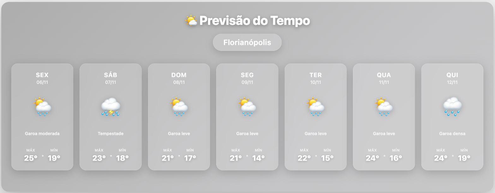
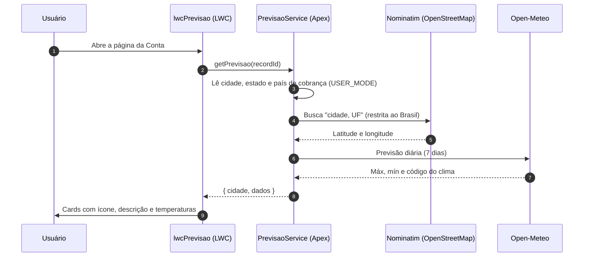

<div align="center">

# 🌤️ Previsão do Tempo para Salesforce

**Previsão de 7 dias direto na página da Conta, a partir da cidade de cobrança.**


<br>



<sub><i>Captura real do componente numa página de Conta (Lightning Experience).</i></sub>

</div>

---

## ✨ O que ele faz

- 📍 **Usa o endereço da própria Conta**: lê cidade, estado e país de cobrança, sem nenhuma configuração extra por registro.
- 📅 **7 dias de previsão**, com dia da semana, data, ícone, descrição em português e temperaturas máxima e mínima.
- 🎨 **Visual em vidro fosco** (glassmorphism), com fundo em gradiente animado e cards com efeito ao passar o mouse.
- 📱 **Funciona no app mobile** do Salesforce, com layout próprio para telas pequenas.
- 🔓 **Não precisa de API key**: usa os serviços abertos [Nominatim](https://nominatim.org) e [Open-Meteo](https://open-meteo.com).
- 🛡️ **Respeita as permissões do usuário** (`WITH USER_MODE`) e mostra mensagens de erro claras.

## ⚙️ Como funciona



1. O componente recebe o `recordId` da Conta e chama `PrevisaoService.getPrevisao`.
2. O Apex lê `BillingCity`, `BillingState` e `BillingCountry` e converte o endereço em coordenadas pelo **Nominatim**. Quando o país é Brasil (ou está vazio), a busca fica restrita ao Brasil, o que evita cair numa cidade homônima de outro país.
3. Com as coordenadas, consulta a previsão diária no **Open-Meteo**, no fuso horário local da cidade.
4. O LWC traduz o [código de clima WMO](https://open-meteo.com/en/docs#weathervariables) em ícone e descrição, e monta os cards.

## 📦 O que vem no projeto

```
force-app/main/default/
├── lwc/lwcPrevisao/               # Componente (HTML, JS, CSS e metadados)
├── classes/
│   ├── PrevisaoService.cls        # Integração com Nominatim e Open-Meteo
│   └── PrevisaoServiceTest.cls    # 9 cenários com HttpCalloutMock
└── remoteSiteSettings/
    ├── nominatim_openstreetmap    # https://nominatim.openstreetmap.org
    └── previsao                   # https://api.open-meteo.com
```

| Tipo | Nome | Para que serve |
| --- | --- | --- |
| LWC | `lwcPrevisao` | Mostra a previsão. Rótulo no App Builder: **Previsão do Tempo** |
| Apex | `PrevisaoService` | Busca as coordenadas e a previsão (`@AuraEnabled getPrevisao`) |
| Apex | `PrevisaoServiceTest` | Testes unitários, com 100% de cobertura |
| Remote Site | `nominatim_openstreetmap`, `previsao` | Liberam as chamadas externas |

## 🚀 Instalação

**Pré-requisitos:** [Salesforce CLI](https://developer.salesforce.com/tools/salesforcecli) e uma org autenticada.

```bash
# 1. Clone o repositório
git clone https://github.com/Manoel-Fr/Salesforce_PrevisaoTempo.git
cd Salesforce_PrevisaoTempo

# 2. Autentique na sua org (se ainda não estiver)
sf org login web -a minhaOrg

# 3. Faça o deploy rodando os testes do projeto
sf project deploy start -o minhaOrg -d force-app \
  --test-level RunSpecifiedTests --tests PrevisaoServiceTest
```

**4. Coloque o componente na página:**

1. Abra qualquer **Conta** → ⚙️ → **Editar página**.
2. Arraste **Previsão do Tempo** (seção *Personalizado*) para a página.
3. **Salvar** → **Ativar**. Para aparecer no celular, ative também para o formato *Telefone*.

> 💡 O componente também pode ser usado em App Page, Home Page, Tab e Experience Cloud, mas lá não existe uma Conta associada. Ele foi pensado para a página de registro de **Account**.

## 💬 Mensagens que o usuário pode ver

| Situação | Mensagem |
| --- | --- |
| Conta sem cidade de cobrança | Cidade de cobrança não informada nesta conta. |
| Cidade não localizada no mapa | Cidade não encontrada: *&lt;cidade&gt;* |
| Erro ao localizar a cidade | Erro ao localizar a cidade (HTTP *xxx*). |
| Erro no serviço de previsão | Erro ao buscar previsão (HTTP *xxx*). |
| Sem conexão ou tempo esgotado | Serviço de previsão indisponível: *&lt;detalhe&gt;* |
| Usuário sem acesso à Conta | Conta não encontrada. |

## 🧪 Testes

```bash
sf apex run test -o minhaOrg -n PrevisaoServiceTest -r human -c
```

Os testes usam `HttpCalloutMock` e não chamam nenhum serviço real. Eles cobrem:

- ✅ Previsão retornada, com a cidade codificada na URL e o cabeçalho `User-Agent` presente
- ✅ Busca com estado e país, restrita ao Brasil quando o país é Brasil ou está vazio
- ✅ Busca sem restrição para contas de outros países
- ✅ Conta sem cidade (nenhuma chamada externa é feita)
- ✅ Cidade não encontrada
- ✅ Erro HTTP no Nominatim e no Open-Meteo
- ✅ Falha de conexão (`CalloutException`)
- ✅ Conta inexistente ou sem acesso

## ⚠️ Limitações conhecidas

- **Cidades com o mesmo nome no Brasil:** sem o estado preenchido, a busca pega a cidade mais relevante com aquele nome no país. Preencha o `BillingState` para acertar sempre (ex.: *Santa Cruz, RN*).
- **Limite de uso do Nominatim:** o serviço público aceita cerca de 1 requisição por segundo e pede um `User-Agent` que identifique a aplicação (já enviado). Para muitos usuários ao mesmo tempo, vale cachear as coordenadas na Conta.
- **Unidades:** temperaturas em °C, arredondadas.

## 🙏 Créditos

- Previsão do tempo: [Open-Meteo](https://open-meteo.com) (CC BY 4.0)
- Geocodificação: [Nominatim](https://nominatim.org), dados © [colaboradores do OpenStreetMap](https://www.openstreetmap.org/copyright) (ODbL)
